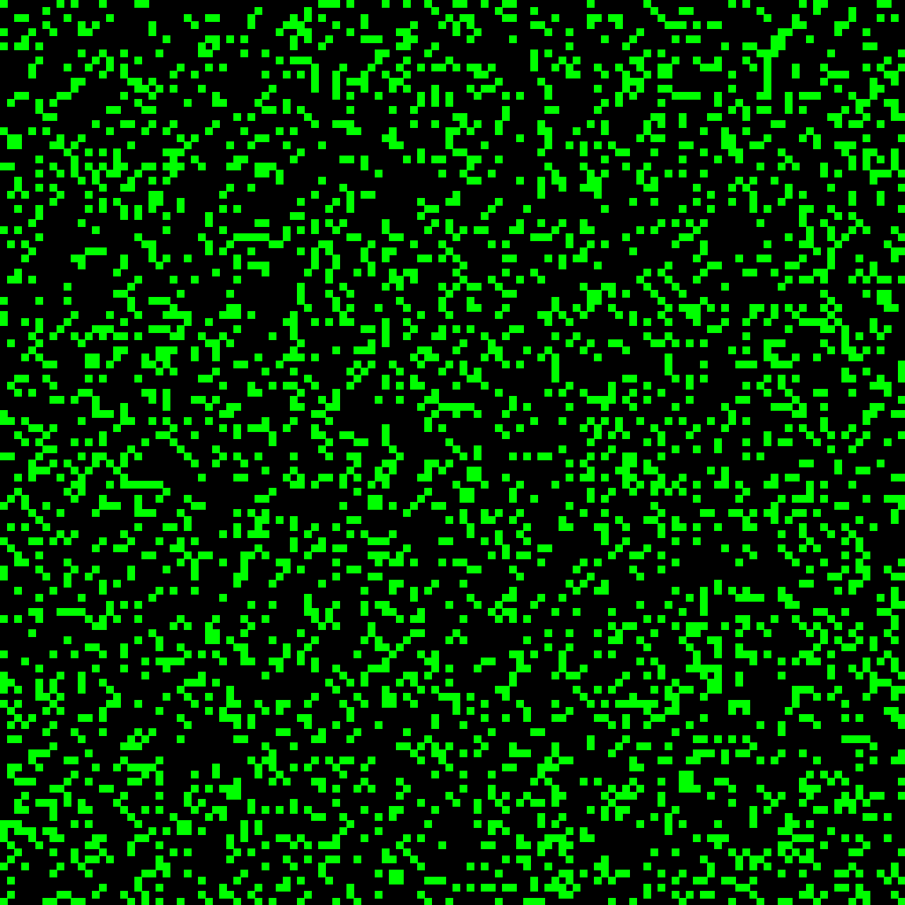

# Sparse Conway Sim


An optimized, toroidal implementation of Conway's Game of Life in Python.

Instead of relying on a traditional bounded 2D array with nested loops, this physics engine uses a **sparse matrix approach**. By leveraging Python `set` and `collections.Counter`, the engine tracks only the coordinates of living cells, completely bypassing the computational overhead of evaluating empty grid space.



> Drop your generated 128x128 `simulation.gif` in the repo root and it will appear here.

---

## Features

- **Sparse Matrix Optimization:** O(k) time complexity per generation (where *k* is the number of living cells) instead of O(N²), allowing for massive, highly efficient simulations.
- **Toroidal Topology:** Applies modulo arithmetic to the coordinate plane to create a wrap-around universe. Patterns like Gliders seamlessly traverse the edges of the grid rather than crashing into invisible walls.
- **Automated Rendering:** Uses `Pillow` to dynamically map the simulation history into 1000+ frame animated `.gif` files, making it possible to observe thermodynamic decay and "ash" stabilization.
- **Defensive Architecture:** Built with object-oriented encapsulation and scalable dynamic variables for grid size and generation limits.

---

## Installation & Usage

Built and tested on **Python 3.11**.

### 1. Clone the repository

```bash
git clone https://github.com/yourusername/sparse-conway-sim.git
cd sparse-conway-sim
```

### 2. Set up the virtual environment

```bash
python -m venv venv

# On Windows:
venv\Scripts\activate

# On Mac/Linux:
source venv/bin/activate
```

### 3. Install dependencies

```bash
pip install -r requirements.txt
```

### 4. Run the simulation

```bash
python main.py
```

The engine will process the generations and output a `simulation.gif` file directly into your directory.

---

## Roadmap: The GUI Update

The current iteration operates as a headless backend engine exporting to a GIF. The next major phase for this project is implementing a fully interactive GUI environment.

Planned updates:

- [ ] A native graphical window (likely using Pygame or Tkinter)
- [ ] Mouse interactivity, allowing the user to pause the simulation and manually "paint" live cells onto the grid
- [ ] Real-time parameter adjustments (e.g., speed sliders and ruleset toggles) without needing to recompile the script
